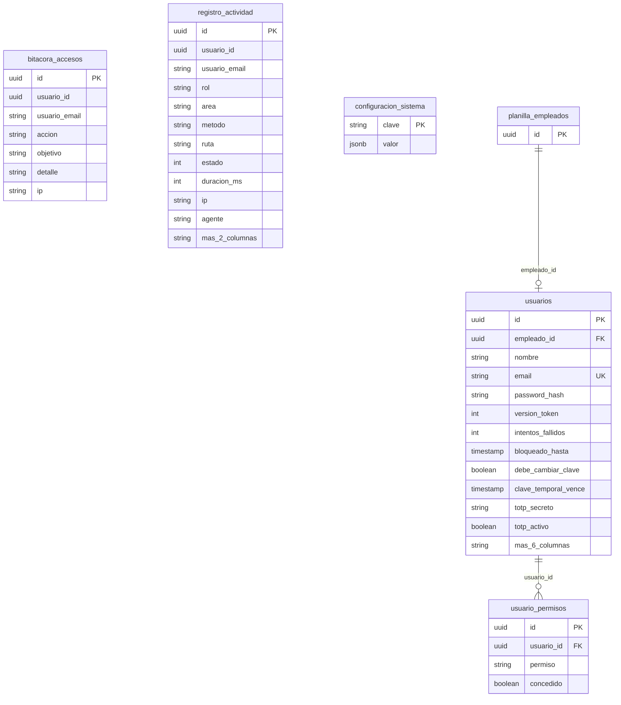
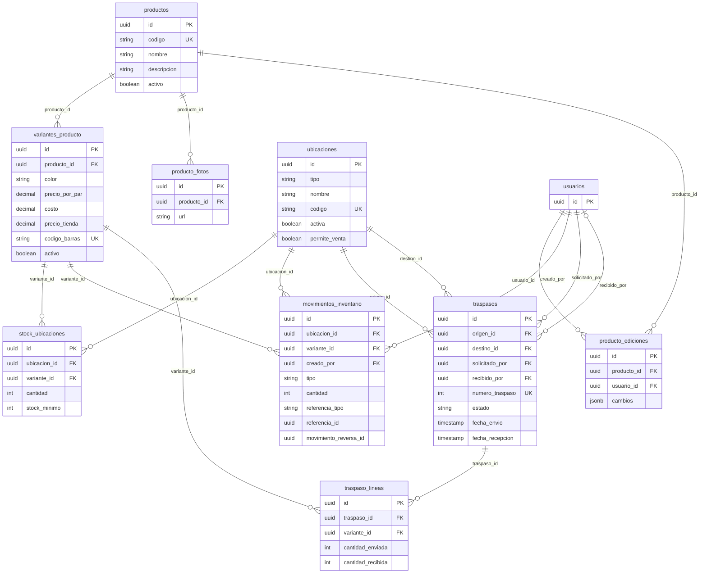
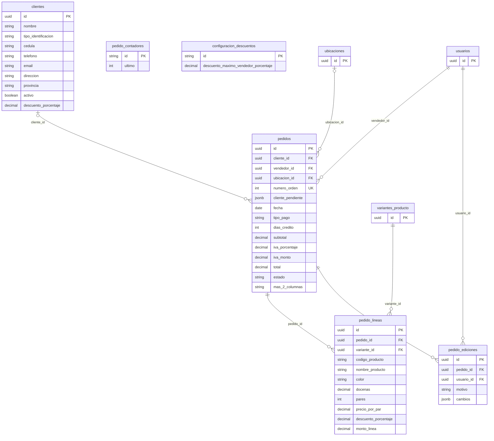
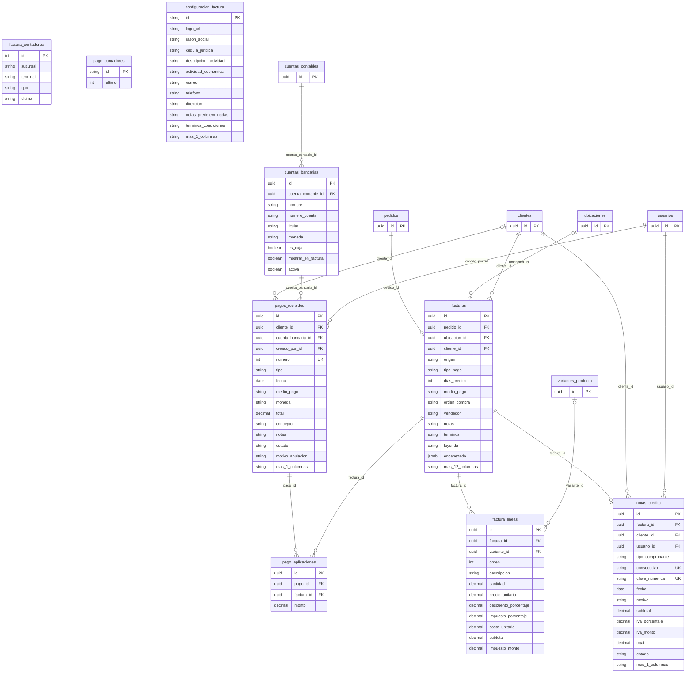
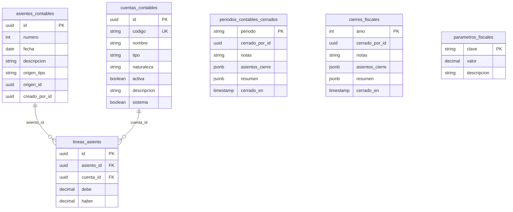
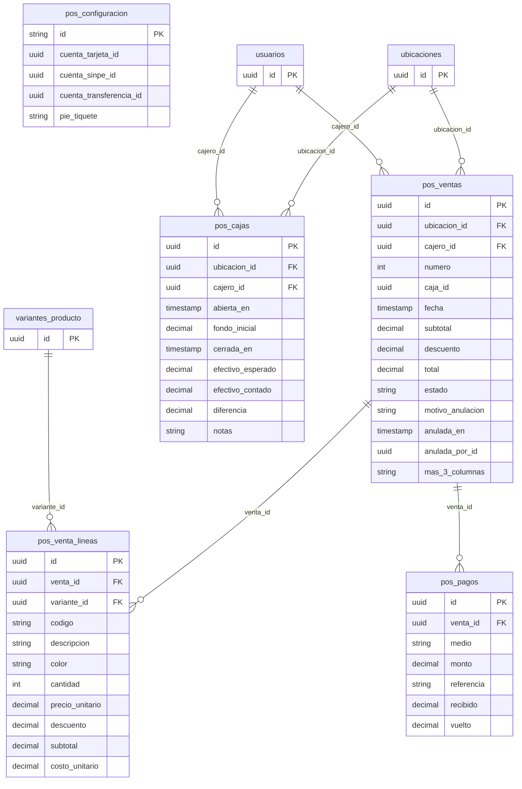
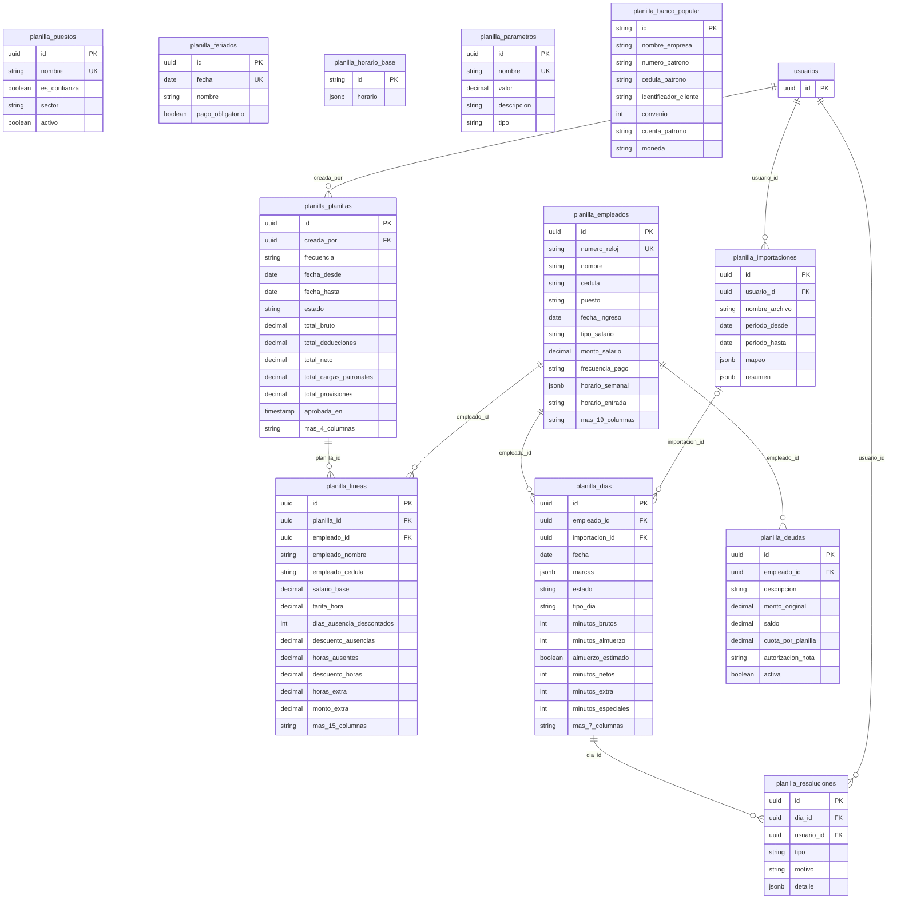

# Base de datos — Sistema Conejo Blanco

Esquema generado desde las entidades de TypeORM (PostgreSQL): **52 tablas**, **56 relaciones** entre tablas.

Cada diagrama muestra una zona del sistema con sus llaves (PK = llave primaria, FK = llave foránea, UK = única) y las columnas principales. Las tablas externas a la zona aparecen solo con su `id`.

Los asientos contables se enlazan con los documentos que los generan (facturas, pagos, planillas, cierres) de forma lógica mediante `origen_tipo` y `origen_id`, sin llave foránea, para poder conservar el historial contable.

## Accesos y sistema

Tablas: `usuarios`, `usuario_permisos`, `bitacora_accesos`, `registro_actividad`, `configuracion_sistema`.

## Catálogo e inventario

Tablas: `productos`, `variantes_producto`, `producto_fotos`, `producto_ediciones`, `ubicaciones`, `stock_ubicaciones`, `movimientos_inventario`, `traspasos`, `traspaso_lineas`.

## Clientes y pedidos

Tablas: `clientes`, `pedidos`, `pedido_lineas`, `pedido_ediciones`, `pedido_contadores`, `configuracion_descuentos`.

## Facturación y cobros

Tablas: `facturas`, `factura_lineas`, `notas_credito`, `factura_contadores`, `pagos_recibidos`, `pago_aplicaciones`, `pago_contadores`, `cuentas_bancarias`, `configuracion_factura`.

## Contabilidad

Tablas: `cuentas_contables`, `asientos_contables`, `lineas_asiento`, `periodos_contables_cerrados`, `cierres_fiscales`, `parametros_fiscales`.

## Punto de venta (POS)

Tablas: `pos_ventas`, `pos_venta_lineas`, `pos_pagos`, `pos_cajas`, `pos_configuracion`.

## Planilla

Tablas: `planilla_empleados`, `planilla_puestos`, `planilla_planillas`, `planilla_lineas`, `planilla_dias`, `planilla_resoluciones`, `planilla_importaciones`, `planilla_deudas`, `planilla_feriados`, `planilla_horario_base`, `planilla_parametros`, `planilla_banco_popular`.

